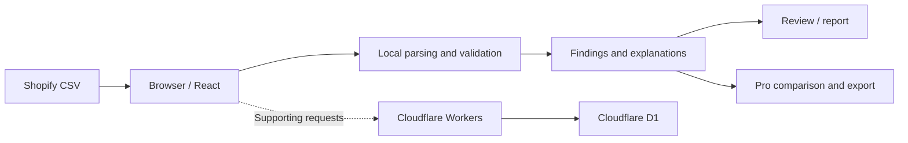

# CataSift

**Shopify CSV validation and preflight, directly in the browser.**

CataSift helps identify catalog-import problems before a Shopify product CSV reaches a store. It checks file structure, required product information, variants, and potentially risky updates, then presents findings with explanations.

**[Try the live application](https://catasift.com/validate)** · **[Explore the published checks](https://catasift.com/checks)** · **[Visit CataSift](https://catasift.com/)**

> **Repository scope:** This is the public project showcase. The application source code is kept in a separate private repository. This repository is not intended to be a runnable source-code release.

## The problem

A Shopify CSV can look fine in a spreadsheet while containing issues that prevent an import or unintentionally change existing store data. Examples include:

- A missing product title on the product's main row.
- An invalid product status, such as `published` instead of a documented Shopify value.
- Repeated SKUs, malformed headers, or conflicting variant options.
- An empty field in an overwrite import that could clear an existing value.

CataSift surfaces findings before the file is imported. It distinguishes documented Shopify requirements from import risks and additional CataSift warnings.

## What the application does

### Free validation

- Checks CSV structure, encoding, headers, and product fields.
- Reviews handles, variants, field values, image URL syntax, and other documented rules.
- Displays the full list of findings with affected fields and suggested fixes.
- Provides a basic downloadable issue report.

### Pro workflows

CataSift also offers paid workflows for:

- **Before-and-after comparison:** identify changes between catalog exports and edited files, including potentially destructive blank-field updates.
- **Corrected CSV export:** download an adjusted file where supported.
- **Reusable rules and supplier profiles:** apply tailored checks across files.
- **Batch validation:** review multiple CSV files and consolidated results.

These are separate from the free validator; see the [live product page](https://catasift.com/) for current access and pricing.

## See the workflow

1. Open **[Validate](https://catasift.com/validate)**.
2. Select a Shopify product CSV, or review the synthetic examples shown on the website.
3. Review findings by severity, affected field, and recommended action.
4. Fix issues in the source CSV and validate again before importing to Shopify.

**Example:** A product's main row has an empty `Title` cell. CataSift flags the affected row and explains why a product title is required. Another check distinguishes a *blank* overwrite value from an *omitted column*—a distinction that can matter when updating existing products.

**[See the full validation-rule catalog](https://catasift.com/checks)** for the published checks and their explanations.

## Architecture and design choices

CataSift uses **JavaScript, React, HTML/CSS, Cloudflare Workers, Cloudflare D1, and Playwright**.

- **Browser-side CSV processing:** catalog CSV contents are read and evaluated in the browser instead of being uploaded wholesale to the application backend.
- **Validation layer:** rules inspect the data and produce findings for the interface to display.
- **User interface:** React presents the results and supports review and export workflows.
- **Supporting services:** Cloudflare Workers and D1 handle supporting application functions, including access/entitlement data. Product catalog files are not stored in D1.

Processing locally reduces unnecessary transfer of potentially business-sensitive catalog data. It is a design choice, **not** a blanket guarantee of privacy or security.

## Testing and iteration

The project has used **Playwright** for browser-level workflow testing in Chromium, Firefox, and WebKit, alongside manual review and debugging. Browser-level tests are relevant here because file selection, validation results, comparison, and export are experienced through the web interface.

Development has involved iterative changes to data checks, UI behavior, reporting, and supporting services. This showcase describes the product and development areas; it does not claim that every feature was implemented independently without tools or assistance.

## Project status

The application is available at **[catasift.com](https://catasift.com/)**. The public showcase intentionally excludes the private implementation, customer data, credentials, and internal configuration.

For a quick look at the product, start with the **[live validator](https://catasift.com/validate)** and the **[published rule catalog](https://catasift.com/checks)**.
