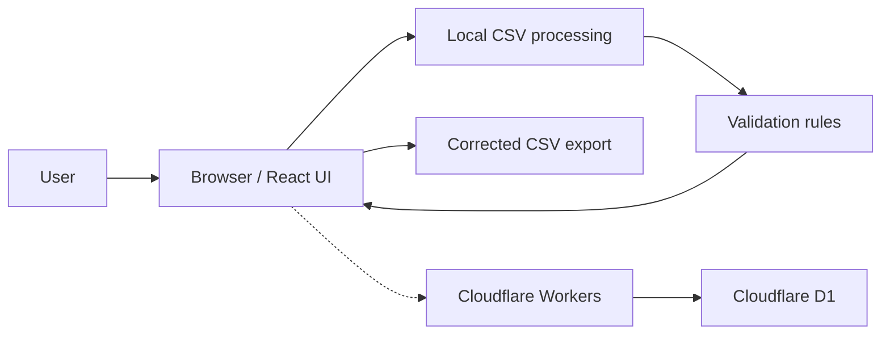

# CataSift

CataSift is a browser-based Shopify CSV validation and preflight application. It helps detect catalog problems before a Shopify CSV import.

🌐 **Live application:** [https://catasift.com/](https://catasift.com/)

> This repository is a public project showcase. The application source code is maintained privately.

## What It Does

CataSift checks Shopify product CSV files before import so catalog issues can be found and reviewed in the browser.

Known functionality includes:

- **Shopify CSV structural validation** — inspects whether the file matches expected Shopify CSV structure
- **Variant and handle consistency checks** — looks for inconsistencies across product variants and handles
- **Image URL checks** — reviews image URLs in the catalog file
- **Formatting checks** — flags formatting problems that can interfere with import
- **Before/after file comparison** — compares files to highlight differences
- **Corrected CSV export** — exports a corrected CSV where applicable
- **Reusable validation rules** — applies validation rules that can be reused across files
- **Supplier profiles** — supports supplier-specific profiles
- **Batch validation** — validates multiple files in a batch

## Why Browser-Based Processing?

Product CSV files can contain business-sensitive catalog information. CataSift reads and processes those files locally in the browser instead of uploading the full catalog to the backend.

That approach reduces unnecessary backend transfer and helps keep catalog data on the user’s device. It is a practical design choice, not an absolute privacy or security guarantee.

## Technology

- JavaScript
- React
- HTML/CSS
- Cloudflare Workers
- Cloudflare D1
- Playwright
- Git

## Architecture Overview

High-level flow:

1. The user selects a Shopify CSV.
2. The browser reads and processes the file locally.
3. Validation rules inspect the catalog data.
4. The React UI displays findings.
5. The user reviews findings and can export corrected data where applicable.
6. Cloudflare Workers and D1 provide supporting application services (including access/entitlement-related data). Product CSV catalogs are not stored in D1.

Supporting services run on Cloudflare Workers. D1 holds supporting application data, not product catalogs.

## Testing

Playwright is used for browser-level end-to-end testing of key workflows.

Tests have been run across:

- Chromium
- Firefox
- WebKit

Browser workflow testing is useful here because the product is a web application: CSV selection, local processing, validation results, comparison, and export all happen in the UI. Checking those paths in multiple engines helps catch issues that unit tests alone would miss.

## What I Worked On

As part of this personal project, I have worked on:

- Browser-based CSV processing so catalog files can be validated locally
- Validation workflows for structure, variants/handles, image URLs, and formatting
- React UI behavior for reviewing findings
- Validation and error reporting
- Corrected CSV export
- Before/after comparison workflows
- Supporting services on Cloudflare Workers and D1 (application data and access/entitlement-related functionality, not catalog storage)
- Cross-browser Playwright testing
- Debugging and iterative feature development

## Screenshots

<!-- Screenshots will be added here. -->

## Development Approach

CataSift was developed iteratively: build a workflow, test it in the browser, identify issues, debug, and revise.

Development has involved Git-based version control, documentation, browser testing with Playwright, and iterative debugging and refinement.

## Current Status

CataSift is a working web application available at [catasift.com](https://catasift.com/). It remains my primary hands-on software project as I continue expanding its validation workflows, testing, and supporting application features.
